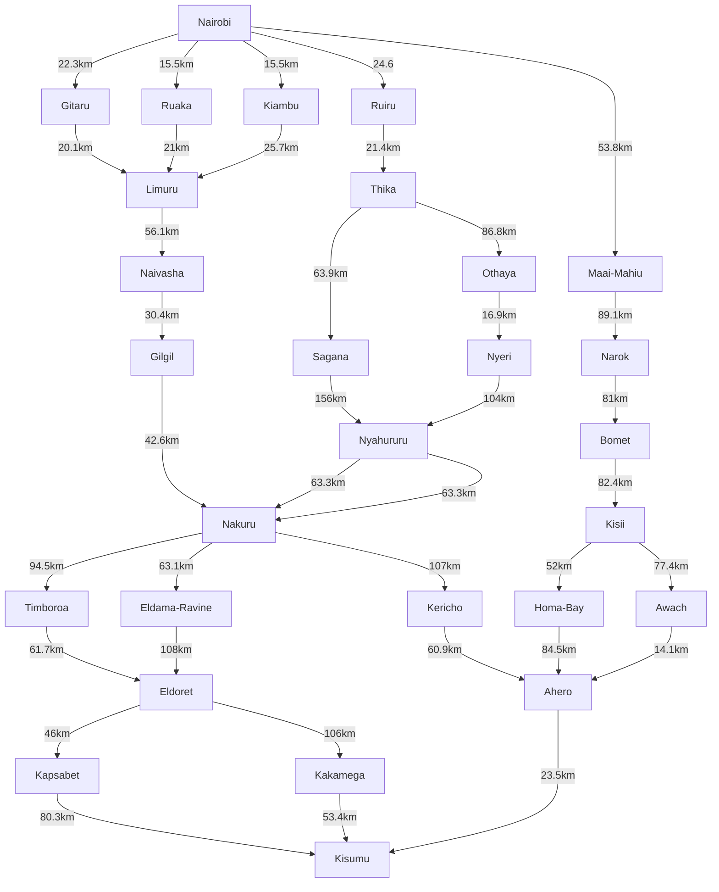

## 1. PEAS Framework & Environment Characteristics
#### A. PEAS Framework for the Self-Driving Trailer Agent
**Performance Measure:**
Find a successfull route to reach the destination (Kisumu from Nairobi).
Use minimal computation time to find the route.
Minimize total distance travelled along said route.

**Environment:**
The physical highway network in Kenya (specifically Nairobi, Central Highlands, Rift Valley, and Lake Victoria Basin).
Google Maps data representation of these regions with locations(nodes), roads(edges) and distances(weights/costs).

**Actuators:**
The mechanism to output the calculated optimal path like a GUI display showing the route, a printed list of waypoints, or map rendering.

**Sensors:**
Google Maps Search/Directions API used to retrieve nodes, edges, and distance inputs.
User interface to receive input about starting point and destination.

#### B. Environment Dimensions
1. **Fully Observable vs. Partially Observable:** **Fully Observable**. The agent has access to the complete map, including all towns and the distances between them before it starts searching.

2. **Deterministic vs. Stochastic:** **Deterministic**. If the agent chooses to move from Nairobi to Nakuru, the outcome is guaranteed (it arrives at the Nakuru node), assuming we are just calculating paths and not driving a physical vehicle.

3. **Episodic vs. Sequential:** **Sequential**. The choice of the next town depends on the current town, and the sequence of decisions impacts the total path cost.

4. **Static vs. Dynamic:** **Static**. For the purpose of finding a distance-based optimal route, the map and distances between towns do not change while the agent is deliberating.

5. **Discrete vs. Continuous:** **Discrete**. The environment is modeled as a finite set of distinct nodes (towns/intersections) and edges (connecting highways), rather than continuous GPS coordinates.

## 2. Directed Graph & Search Tree (with Abstraction)
#### A. Directed Graph of Candidate Road Networks

### Applying Abstraction (removing unnecessary details)
* We ignore:
  *the physical curvature of the roads, speed limits, traffic lights, and scenery.
  *minor villages or sub-locations.

* We model the environment as a directed graph using:
  * **Nodes (Vertices):** Major towns (Nairobi, Naivasha, Nakuru, Kericho, Eldoret, Kisumu, Narok, Bomet, etc.).
  * **Edges (Arcs):** The major highways connecting these towns.

### Developing the Directed Graph

Using the Google Maps view of the specified Kenyan regions, we extracted a simplified graph with these connections:

#### B. Search Tree (Applying Abstraction)

## 3. Path Cost Function & Optimal Path Determination
#### A. Distance Breakdown by Road Segment
#### B. Route Path Cost Evaluation
#### C. Optimal Path Conclusion

## 4. Group Work Evidence
### Meeting Minutes
- **Date**: 07/10/2026
- **Platform**: Google Meet
- **Members Present**: Albert Miricho, Sean Nguyo, Sydney Aisha
- **Agenda**:
  1. Problem formulation and PEAS definition.
  2. Construction of a highway-directed graph and abstraction tree.
  3. Distance verification on Google Maps.
  4. Repository fork verification and Markdown documentation compilation.

#### Team Photo
(./team_photo.jpg)
